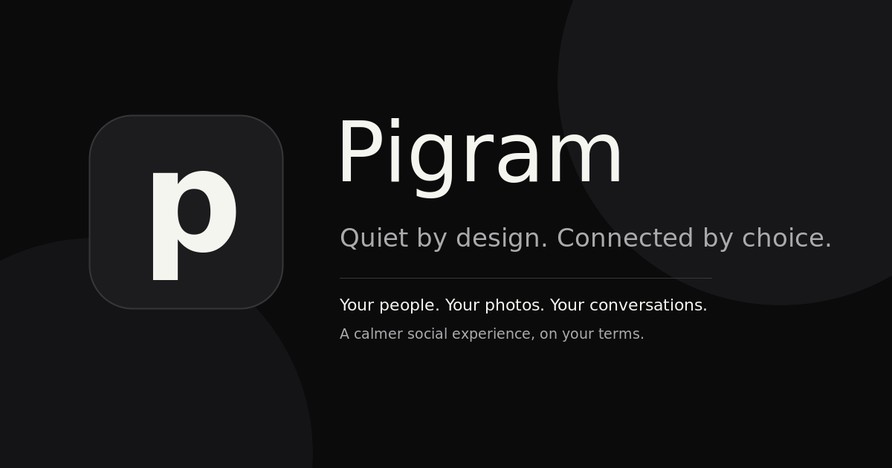

<div align="center">
  
  <h1>Pigram</h1>
  <p><strong>Quiet by design. Connected by choice.</strong></p>
  <p>
    Pigram is an open-source Android patch for the official Instagram app. It keeps the
    social features people use — including direct messages, stories, profiles and the
    home feed — while making recommendations, Reels, ads and other distractions optional
    or easier to avoid.
  </p>
</div>

<p align="center">
  <a href="https://github.com/mykrwt/pigram"></a>
  <a href="LICENSE"></a>
</p>

<p align="center">
  <a href="docs/INSTALL.md">Install</a> ·
  <a href="docs/BUILD_FROM_SOURCE.md">Build from source</a> ·
  <a href="docs/FAQ.md">FAQ</a> ·
  <a href="docs/PRIVACY.md">Privacy</a> ·
  <a href="https://github.com/mykrwt/pigram/issues">Issues</a>
</p>

## What Pigram keeps and lets you tune

| Keep using Instagram for | Optional distraction controls |
|--------------------------|-------------------------------|
| Direct messages and private chats | Reels and Explore surfaces |
| Home feed and posts from followed accounts | Suggested accounts and ads |
| Stories, search, profiles and notifications | Feed visibility and navigation shortcuts |

On a new installation, the home feed is visible by default. **Following feed only** is enabled
by default to request posts from followed accounts where Instagram supports that mode. You
can turn it off or hide the feed entirely in Pigram settings. Direct messages are not
blocked or replaced by this project; they continue to use Instagram's existing service
and access controls.

Pigram is an unofficial, independent project and is not affiliated with Instagram or
Meta. It modifies the official Android app; installation and continued compatibility
depend on Instagram's app and service. Use at your own risk.

## Preview

<p align="center">
  
</p>

## What Pigram does NOT do

Pigram does not:

- bypass Instagram login;
- collect your password or session tokens;
- proxy your traffic through a third-party server;
- add tracking or analytics;
- scrape accounts;
- sell or transmit user data;
- claim affiliation with Instagram or Meta.

## Why Pigram?

Unlike WebView-based alternatives, Pigram patches the real Android Instagram app.

Unlike accessibility-service blockers, it does not simply react to the interface after it loads.

Unlike closed-source Instagram mods, every patch is public and auditable.

Pigram is built for people who want to keep Instagram's useful social features without the addictive parts.

Pigram is derived from the GPL-licensed [Feurstagram](https://github.com/jean-voila/FeurStagram) project. It continues the patch-based approach while developing an independent Pigram identity. See [NOTICE](NOTICE) for project and third-party attributions.

**Pigram is free and open-source.** Contributions and forks are welcome under the terms of the [GPL-3.0 license](LICENSE).

## Documentation

- [Installation guide](docs/INSTALL.md)
- [Build from source](docs/BUILD_FROM_SOURCE.md)
- [FAQ](docs/FAQ.md)
- [Privacy](docs/PRIVACY.md)
- [Contributing](CONTRIBUTING.md)
- [Security policy](SECURITY.md)

## Implementation limits

Pigram is a patch set, not a standalone social network. It does not implement a chat backend, profiles, a new feed renderer, or story storage; those remain Instagram features. The cloned app label can be changed to Pigram, but the launcher icon and Instagram splash screen are inherited from the supplied APK. Pigram's custom settings panel is dark-only today; it does not provide a separate light/system appearance switch. See [the engineering audit](docs/ENGINEERING_AUDIT.md) for the baseline and verification limits.

## Updates

When Pigram releases are published on GitHub, the optional in-app updater can check
for a newer version. It can be disabled in settings. This project does not operate an
official Instagram account or promise social-media update notices.

## Codemagic Android releases

The `pigram-android-release` workflow uses the existing `build.sh` pipeline: it builds the Morphe patch bundle, applies it to a supplied Instagram APK with the pinned Morphe CLI, signs the Pigram clone, verifies the signature, and publishes `Pigram-vMAJOR.MINOR.PATCH.apk`. It runs only when a matching Git tag is pushed; it does not build every branch or run on a manual Codemagic “Start new build” request.

### One-time Codemagic setup

1. Connect `mykrwt/pigram` to Codemagic and enable the repository webhook/tag events.
2. On an **individual Codemagic account**, add an environment-variable group named `pigram_release_secrets` with:
   - `INSTAGRAM_APK_URL`: secret direct HTTPS URL to a user-provided **universal `.apk`**. The source Instagram APK is not stored or released by this repository.
   - `MORPHE_PACKAGE_USER` and secret `MORPHE_PACKAGE_TOKEN`: GitHub username and a token with `read:packages` access to Morphe's Gradle package.
   - secret `GH_TOKEN`: fine-grained GitHub token scoped to `mykrwt/pigram`, with **Contents: read and write** permission. It is used only to create the release and upload the APK.
3. In Codemagic Android code signing, upload the long-term Pigram **PKCS#12** keystore and alias as `pigram_release_keystore`. The workflow reads Codemagic's protected signing identity; do not commit a keystore or passwords.
4. Confirm that the account is the Codemagic Free **individual** plan. Current pricing documentation (checked 2026-10-16) lists 500 monthly minutes on macOS M2 for individual accounts; teams receive no free minutes, and Linux/Windows builds are paid. This workflow therefore uses `mac_mini_m2`, limits itself to tag releases, and skips branch validation. See [Codemagic pricing](https://docs.codemagic.io/billing/pricing/) and [GitHub Release publishing](https://docs.codemagic.io/yaml-distributing/github-releases/).

### Start a release

After the workflow is merged to `main`, update `CHANGELOG.md` and create a new, never-before-used version tag from the release commit. The repository has no prior Git tags; its current Gradle version is `1.0.0`, so the initial tag convention is `v1.0.0`.

```sh
git switch main
git pull --ff-only origin main
# Update and commit CHANGELOG.md (and any release content) first.
git tag -a v1.0.0 -m "Pigram v1.0.0"
git push origin v1.0.0
```

For later releases, increment the semantic version (`v1.0.1`, `v1.1.0`, etc.) and push the new tag. Codemagic validates the exact `vMAJOR.MINOR.PATCH` format, uses that tag for the Gradle patch version and APK filename, records the commit SHA, and uses the matching `CHANGELOG.md` section (or `Unreleased`) for the release notes. A duplicate GitHub Release is rejected rather than overwritten.

Download the APK and signature-verification report from Codemagic’s build artifacts; a successful tag build also creates the corresponding GitHub Release with the versioned APK attached. The APK signature is verified with Android `apksigner`; this does **not** establish compatibility with every device or guarantee an update over an installation signed with a different key. Reuse the same keystore for updates. If no compatible Pigram signing key exists, users may need to uninstall the older build first, which can remove local app data.

### Troubleshooting

- **No build starts:** check the repository webhook and that the pushed tag matches `v*`.
- **Tag rejected:** use exactly `vMAJOR.MINOR.PATCH`; never reuse a released tag.
- **Download or Gradle failure:** check that the direct URL still serves a universal APK and that the Morphe package token has `read:packages` access.
- **Signing failure:** recheck the Codemagic code-signing reference, alias and passwords; never paste credentials into logs.
- **Release upload failure:** verify the fine-grained `GH_TOKEN` has `Contents: read and write` for this repository and that the release does not already exist.
- **Build minutes exhausted:** the individual Free allowance is monthly; avoid unnecessary tag builds and check current Codemagic pricing/account type.

## Contact

For project questions or bug reports, please use the [GitHub issues](https://github.com/mykrwt/pigram/issues).

## Installation

You have two options:

1. **Ready-to-install APK** - Grab the latest patched APK from the [Releases](../../releases) page and install it directly
2. **DIY Patching** - Use the toolkit below to patch any Instagram version yourself

## What is configurable

All content blocks are **individual runtime toggles** — long-press the Home
tab at the bottom-left of the main tab bar to open the Pigram settings
page and check/uncheck what you want blocked. A single APK covers every
combination.

| Feature | Default | Toggleable | How |
|---------|---------|------------|-----|
| **Home Feed** | Visible | Yes | Network-level blocking |
| **Following feed only** | On | Yes | Feed-request header rewrite |
| **Explore** | Blocked | Yes | Network-level blocking |
| **Reels** | Blocked | Yes | Network-level blocking + Tab hidden |
| **Stories** | Visible | Yes | Network-level blocking |
| **Suggested accounts** | Blocked | Yes | Network-level + feed-parse blocking |
| **Instants (+ button in DMs)** | Blocked | Yes | View visibility hidden |
| **Notes (text bubbles above DMs)** | Blocked | Yes | View visibility hidden |
| **Ads** | Blocked | Yes | Network-level + feed-parse blocking |
| **Analytics & telemetry** | Blocked | No | Always blocked |
| **Shopping / commerce preloads** | Blocked | No | Always blocked |

**Following feed only** requests Instagram's Following timeline rather than the ranked
recommendation feed. The setting is on by default; account and server behavior can affect
what Instagram actually returns.


## What Still Works

| Feature | Status |
|---------|--------|
| **Direct messages** | Inherited from Instagram; not modified by Pigram or separately verified here |
| **Profile** | Inherited from Instagram; not modified by Pigram |
| **Reels shared in DMs** | Inherited from Instagram; not modified by Pigram |
| **Search** | Inherited from Instagram; not modified by Pigram |
| **Notifications** | Inherited from Instagram; not modified by Pigram |
| **Deep links** | Patched for re-signed builds; not end-to-end tested in this workspace |

## Settings Page

**Long-press the Home tab** (the house icon at the bottom-left of Instagram's
main tab bar). A full-screen, scrollable settings page opens with restrained monochrome surfaces and padding for system bars and cutouts. This is the patched app settings panel, not a replacement Instagram shell. It includes:

- **Your experience** — toggles for hiding the Home Feed, Explore, Reels, Stories,
  Suggested accounts, Ads, Instants, and Notes.
- **Navigation bar** — show or hide each bottom-bar icon (Search, Reels,
  Create, Messages, Profile) independently of the content blocks. Home always
  stays, since long-pressing it is how you get back here. A swipe that would
  land on a hidden tab carries straight on to the next visible one, so a hidden
  section stays hidden instead of being one flick away.
- **Feed** — *Following feed only*: restrict the Following timeline from accounts you
  follow instead of the ranked recommendation feed where supported. Has effect only
  when the Home Feed is left visible.
- **Display** — *Force dark (disable HDR)* (on by default): stops Instagram
  forcing its window into HDR mode, which lifts the black floor and washes out
  the dark UI on HDR OLED screens. Turn it off to keep Instagram's HDR behaviour.
- **Landing page** — choose which surface the app jumps to on cold start
  (Home feed, Search, Direct messages, or Profile). A surface whose navigation
  icon is hidden can't be picked, and stops being used if you hide it later:
  landing on it would hand back exactly what you removed.
- **Updates** — after an update, the first launch shows a **What's new** card with
  that version's release notes. Then, *Automatic update check* (on by default): on launch,
  Pigram can check GitHub for a newer release and, if one exists, opens a page showing what changed in it. Choosing *Update* downloads the
  APK on a progress page you can cancel — or leave, in which case the download
  carries on in a notification — then hands it to Android's installer. No
  browser, no manual download. Turn the check off here if you'd rather look
  yourself.
- **Pigram on GitHub** — opens the project source and issue tracker.
- **Permanent lock** and **Done** buttons pinned at the bottom so they stay
  reachable on any screen size.

Settings persist in the legacy SharedPreferences file `feurstagram_prefs`; its internal name is retained intentionally so existing settings survive the rebrand.

Once you change any setting, the page can only be left by restarting: both
**Done** and **Back** clear the cache and relaunch, so a changed block can
never leave the app in a half-applied state with stale content still loaded.
If you open the page and change nothing, Back simply closes it.

### Permanent lock

The permanent lock freezes your restrictions for this installation. It only
prevents *relaxing* them: you can still make settings **stricter** (turn a
block on), but you cannot turn a block back off without reinstalling.

The freeze is captured per settings session, not the instant you flip a
switch. When you open settings, Pigram snapshots the current visibility state;
only surfaces already hidden stay locked. A surface you hide by
mistake during a session can still be shown again **until you tap Done** —
Done clears the cache and restarts, which bakes the new state in as the next
snapshot. This means a stray tap on a surface (e.g. Stories) is recoverable
within the same session instead of forcing a reinstall.


## Requirements

- JDK 21 and the Android SDK (`ANDROID_HOME` set, build-tools installed)
- A GitHub token with the `read:packages` scope in `~/.gradle/gradle.properties`,
  used to fetch the patcher dependency:
  ```properties
  gpr.user=<your-github-username>
  gpr.key=<token-with-read:packages>
  ```

## Build from source

1. **Download an Instagram APK** from [APKMirror](https://www.apkmirror.com/apk/instagram/instagram-instagram/) (arm64-v8a recommended).

2. **Build and apply:**
   ```bash
   ./build.sh instagram.apk
   ```
   Add `--clone` to install Pigram **alongside** a stock Instagram (separate
   package and data), and `--install` to push it to a connected device:
   ```bash
   ./build.sh instagram.apk --clone --install
   ```
   The signed result is written to `pigram.apk`.

## Project structure

```
Pigram/
├── build.sh                      # Build the bundle and apply it to an APK
├── patches/                      # Patches (Kotlin): where to inject, by fingerprint
│   └── src/main/kotlin/com/pigram/patches/
│       ├── network/              # Network blocking + feed-item filter + following-feed
│       ├── settings/             # Long-press settings entry point (tab bar)
│       ├── signature/            # Signing-cert trust bypass (deep links)
│       ├── display/              # Force SDR (disable Instagram's forced HDR window)
│       ├── debug/                # ADB settings bridge (dev only, --debug)
│       └── clone/                # Side-by-side package/label rename
└── extensions/                   # Runtime code (Java), compiled and merged in
    └── .../com/pigram/extension/
        ├── Block.java            # URI blocking rules + feed-item type filter
        ├── LimitFeed.java        # Following-feed header rewrite
        ├── Config.java           # SharedPreferences toggles + permanent lock
        ├── Settings.java         # Settings dialog
        ├── Display.java          # Window colour-mode control (Force dark / SDR)
        ├── Hiders.java           # Nav-tab / Notes / Instants hiders + landing redirect
        ├── HiddenTabSwipeSkipper.java  # Keeps swipes off hidden tabs' pages
        ├── DebugBridge.java      # Dev-only ADB bridge over the settings (--debug builds)
        └── UpdateChecker.java    # On-launch GitHub release check
```

## Design

Pigram's own screens follow Material 3 Expressive in a monochrome dark scheme —
white is the only accent, and everything is built in code because the mod has no
resources of its own. The tokens, shapes, type scale, component rules and the
window-inset requirements are written down in [docs/DESIGN.md](docs/DESIGN.md); read it
before changing or adding any UI.

## Signing

The bundle is signed during `build.sh`. Set `PIGRAM_KEYSTORE_PASS` (and
optionally `PIGRAM_KEY_PASS`) to sign with `pigram.keystore`;
otherwise a throwaway keystore is generated. Reuse the same keystore across
builds to install updates without uninstalling first.

## Debugging

Blocked requests surface as `java.io.IOException: Blocked by Pigram` in
logcat:
```bash
adb logcat | grep "Blocked by Pigram"
```

## How It Works

Patches locate their injection points by **fingerprint** (matching code by
stable traits like class names, strings and method shapes) rather than by
obfuscated names, so they keep applying across Instagram updates. The runtime
logic lives in compiled extension classes that are merged into the app.

### Settings Hook
A fingerprint matches the main tab-bar binder and injects a watcher on it. The
watcher resolves the `feed_tab` id via `Resources.getIdentifier(...)`, grabs
the Home tab once laid out, and installs a long-press listener. Long-pressing
opens a full-screen Material dark page: content toggles plus a landing-page
selector, all backed by `SharedPreferences` (`feurstagram_prefs`, retained for compatibility). The same
hook installs the navigation-tab/Notes/Instants hiders, the hidden-tab swipe
skipper and the cold-start landing-page redirect.

### Network Blocking
A fingerprint matches `TigonServiceLayer.startRequest` (a named class) and
injects a call on the request URI. Blocked calls throw an `IOException`, so the
surface fails to load and stays empty.

### Feed Item Filtering
Network blocking can't touch ads and "suggested" units that Instagram injects
**inline** into the Home Feed payload — they arrive inside the normal
`/feed/timeline/` response, not on a separate URL. A second fingerprint matches
the feed-item JSON deserialiser (by the stable wire-format type tokens like
`clips_netego` and the `parseFromJson` method name) and rewrites a blocked
unit's type token to an invalid one. Instagram's own parser then routes it to
its "unknown FeedItem type" branch and drops it — no crash. Ad/promo units are
gated on the **Ads** toggle, suggested/netego units on the **Suggested
accounts** toggle.

### Following Feed Only
A fingerprint matches the main-feed request class (by its debug-string shape)
and rewrites the request's `pagination_source` header from the recommended feed
to `following`, so the Home Feed returns only accounts you follow. The header
field is obfuscated, so it is resolved dynamically each build rather than
hardcoded. Gated on the **Following feed only** toggle.

### Deep-link signature bypass
Instagram checks that the running APK is signed by Meta before it follows a deep
link into its own content. A re-signed Pigram build fails that check, so
shared links (posts, reels, profiles) silently dropped to the home feed. A patch
forces Instagram's signing-certificate trust checks to always pass, so it treats
the build as genuine and deep links resolve normally. It matches on a stable
error string rather than obfuscated names, so it needs no per-version
maintenance. Fixes #36 and #106.

### Force SDR display
Instagram switches its window into HDR mode at runtime (server-gated per
account), which lifts the black floor on HDR OLED panels and leaves the flat dark
UI looking washed out for no benefit. A patch reroutes every window colour-mode
change through an extension helper that pins the window to SDR when the **Force
dark** toggle is on (default), keeping blacks deep; turning it off passes
Instagram's original colour mode through untouched. It hooks the framework
`Window.setColorMode` call, so it too needs no per-version maintenance.

#### Blocked network paths

| Path / pattern | Purpose | Toggleable |
|----------------|---------|------------|
| `/feed/timeline/` | Home feed posts | Yes |
| `/feed/reels_tray` | Stories tray | Yes |
| `/discover/topical_explore` | Explore tab content | Yes |
| `/clips/home/`, `/clips/discover`, `/clips/get_blend_medias/` | Reels feed + discovery + Blend reels | Yes |
| `/discover/ayml/`, `/discover/sectioned_ayml/`, `/discover/chaining/`, `/discover/recommended_accounts_for_category/`, `/discover/suggested_businesses/`, `/discover/recs_from_friends_suggestions/`, `/discover/recs_from_friends_user_info/`, `/discover/surface_with_su/`, `/discover/fetch_suggestion_details/`, `/discover/account_discovery/`, `/discover/reshare_suggestions/`, `/fbsearch/accounts_recs/`, `/friendships/feed_favorites_suggestions/`, `/friendships/share_to_friends_story_suggested_users/`, `/direct_v2/search_friending_suggestions/`, `/business/discovery/suggest_business/` | Suggested-account recommendations (profile "Suggested for you", stories-tray injected accounts, search null-state recs, post-follow chaining, friend/business suggestions) | Yes |
| `/api/v1/ads/` (all `ads/*`), `/feed/async_ads_ranking/`, `/feed/shop_everything_feed_of_ads*`, `/feed/user_interests_contextual_feed_of_ads/`, `/discover/chaining_experience_contextual_ads/`, `/discover/chaining_experience_notification_ads/`, `/direct_v2/ads_for_ctd_ads_thread_view/`, `/direct_v2/should_show_ad_responses_tab/`, `/profile_ads/get_profile_ads/`, `/stories/stories_high_intent_discovery_ads/`, `/stories/stories_intent_aware_ads/`, `/commerce/product_collections/ads_collection_page/` | Sponsored ads injected into the feed, stories, profile, DMs, Explore chaining and commerce | Yes |
| `/logging/` | Client event logging | No |
| `/async_ads_privacy/` | Ad-related tracking | No |
| `/async_critical_notices/` | Engagement nudge analytics | No |
| `/api/v1/media/.../seen/` (path contains `/api/v1/media/` and `/seen`) | Post “seen” tracking | No |
| `/api/v1/fbupload/` | Telemetry upload | No |
| `/api/v1/stats/` | Performance / usage stats | No |
| `/api/v1/commerce/`, `/api/v1/shopping/`, `/api/v1/sellable_items/` | Shopping / commerce preloads | No |

Note: despite the name, `/feed/reels_tray` is the stories tray endpoint in Instagram internals.

Matching uses `String.contains()` on the URI path. Instagram changes URL shapes over time; adjust the rules in `extensions/.../Block.java` if a block stops matching.

## Updating for New Instagram Versions

Because patches are fingerprint-based, a new Instagram version usually just
needs a rebuild (`./build.sh <new-instagram.apk>`). If Instagram restructures a
targeted area, only the affected fingerprint needs adjusting.


## Contributing

This is a personal project I'm sharing with the community. Contributions are welcome!

- 🍴 **Fork it** - Make your own version
- 🔧 **Pull requests** - Improvements and fixes are appreciated
- 📋 **Copy it** - Use the code however you want
- ✨ **Enhance it** - Build something even better

## License

This project is released under the GNU General Public License v3.0. See [LICENSE](LICENSE) for details.

Built with the [Morphe](https://morphe.software) patcher and adapts Instagram
patch ideas from [Piko](https://github.com/crimera/piko), both GPLv3. See
[NOTICE](NOTICE) for attribution. Pigram is an independent project, not
affiliated with or endorsed by Morphe or Piko.
